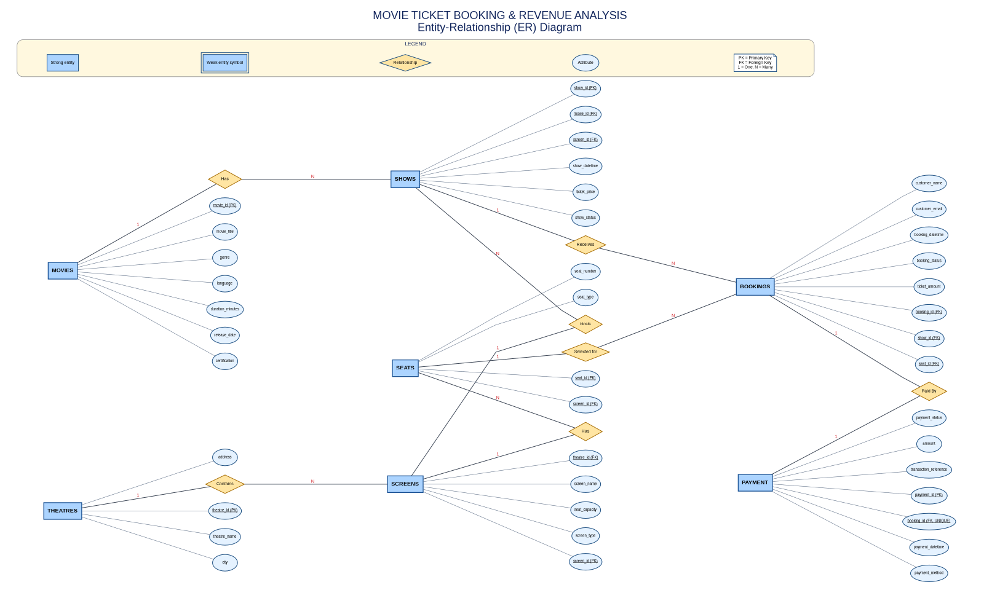

# 🎬 Movie Ticket Booking & Revenue Analysis (SQL Project)

A beginner-to-medium **MySQL database project** for analysing movie showtimes, cinema seat occupancy, ticket bookings, payment records, revenue, cancellations, and booking trends.

The project demonstrates how a relational database can turn ticket-booking records into useful business information. It includes database design, sample data, indexes, views, stored procedures, triggers, analysis queries, an ER diagram, a PowerPoint presentation, and beginner-friendly running notes.

---

## 📌 Table of Contents

- [Project Overview](#-project-overview)
- [Business Problems](#-business-problems)
- [Project Objectives](#-project-objectives)
- [Tools and Technologies](#-tools-and-technologies)
- [Database Schema](#-database-schema)
- [Entity-Relationship Diagram](#-entity-relationship-diagram)
- [Relationships and Cardinality](#-relationships-and-cardinality)
- [Features Implemented](#-features-implemented)
- [Key Business Analyses](#-key-business-analyses)
- [Project Folder Contents](#-project-folder-contents)
- [How to Run the Project](#-how-to-run-the-project)
- [Example SQL Commands](#-example-sql-commands)
- [Business Rules and Assumptions](#-business-rules-and-assumptions)
- [Learning Outcomes](#-learning-outcomes)
- [Possible Future Enhancements](#-possible-future-enhancements)
- [Author](#-author)

---

## 🎯 Project Overview

Movie theatres need to understand which movies attract customers, which showtimes fill seats, how much revenue is collected, and how cancellations affect bookings. This project models a small cinema ticket-booking system and uses SQL to answer those questions.

The database is named **`movie_ticket_booking`** and contains seven main business tables:

1. `movies`
2. `theatres`
3. `screens`
4. `shows`
5. `seats`
6. `bookings`
7. `payments`

The project uses fictional sample data for practice and demonstration. It is intended as a learning project, not a production-ready ticketing platform.

## 🧩 Business Problems

This project answers questions such as:

- Which movies earn the most revenue from successful payments?
- Which showtimes have the highest and lowest seat occupancy?
- Is revenue higher on weekdays or weekends in the sample data?
- How many bookings are confirmed, pending, completed, or cancelled?
- What percentage of bookings are cancelled?
- How does booking activity change from one date to another?
- Which theatres and payment methods contribute the most revenue?
- Are bookings and payments following the project's data rules?

## ✅ Project Objectives

- Design a relational database with primary keys and foreign keys.
- Represent the relationships between movies, theatres, screens, shows, seats, bookings, and payments.
- Insert sample data that can be used to practise SQL.
- Use `JOIN`, `GROUP BY`, `ORDER BY`, `HAVING`, aggregate functions, `CASE`, and date functions.
- Create indexes for commonly searched and joined columns.
- Create views for reusable analysis.
- Create stored procedures for repeatable tasks.
- Create triggers to validate selected records and track booking-status changes.
- Document the project so a beginner can run it and explain it during a presentation or interview.

## 🛠 Tools and Technologies

| Tool / Concept | Purpose |
|---|---|
| MySQL 8.0+ | Relational database and SQL execution |
| MySQL Workbench | Run scripts, inspect tables, and test queries |
| SQL | Create tables, insert data, and analyse results |
| ER Diagram | Visualise entities, attributes, keys, and relationships |
| Microsoft PowerPoint / compatible viewer | Present the project |
| Git and GitHub | Version control and project portfolio |

## 🗃 Database Schema

### 1. `movies`

Stores information about each movie.

| Column | Purpose |
|---|---|
| `movie_id` | Primary key; unique movie ID |
| `movie_title` | Movie title |
| `genre` | Genre, such as Action or Comedy |
| `language` | Movie language |
| `release_date` | Release date |
| `duration_mins` | Runtime in minutes |
| `certificate` | Age/certification category |

### 2. `theatres`

Stores cinema/theatre details.

| Column | Purpose |
|---|---|
| `theatre_id` | Primary key |
| `theatre_name` | Theatre name |
| `city` | City where the theatre is located |
| `address` | Address or area |

### 3. `screens`

Stores the screens available inside each theatre.

| Column | Purpose |
|---|---|
| `screen_id` | Primary key |
| `theatre_id` | Foreign key referencing `theatres` |
| `screen_name` | Screen name/number |
| `screen_type` | Screen format, such as 2D, 3D, or IMAX |

### 4. `seats`

Stores the seats available on each screen.

| Column | Purpose |
|---|---|
| `seat_id` | Primary key |
| `screen_id` | Foreign key referencing `screens` |
| `seat_number` | Seat label, such as A1 |
| `seat_type` | Regular, Premium, or Recliner |

A unique constraint on `(screen_id, seat_number)` prevents duplicate seat labels within one screen.

### 5. `shows`

Stores each scheduled movie show.

| Column | Purpose |
|---|---|
| `show_id` | Primary key |
| `movie_id` | Foreign key referencing `movies` |
| `screen_id` | Foreign key referencing `screens` |
| `show_datetime` | Date and start time |
| `ticket_price` | Ticket price for the show |
| `show_status` | Scheduled, Completed, or Cancelled |

### 6. `bookings`

Stores ticket booking information. In this learning model, **one booking row represents one seat for one show**.

| Column | Purpose |
|---|---|
| `booking_id` | Primary key |
| `show_id` | Foreign key referencing `shows` |
| `seat_id` | Foreign key referencing `seats` |
| `customer_name` | Customer name |
| `customer_email` | Customer email |
| `booking_datetime` | When the booking was created |
| `booking_status` | Booking status |
| `ticket_price` | Price recorded for the booking |

A unique constraint on `(show_id, seat_id)` prevents the same seat from being booked more than once for the same show.

### 7. `payments`

Stores payment information associated with bookings.

| Column | Purpose |
|---|---|
| `payment_id` | Primary key |
| `booking_id` | Unique foreign key referencing `bookings` |
| `payment_datetime` | Payment date and time |
| `payment_method` | UPI, Card, Cash, Net Banking, or Wallet |
| `payment_status` | Successful, Pending, Failed, or Refunded |
| `amount` | Payment amount |
| `transaction_ref` | Transaction reference |

The unique constraint on `payments.booking_id` means **a booking can have at most one payment record**. A booking can exist before its payment record is created. Therefore, the database relationship is optional one-to-one from booking to payment (one booking has zero or one payment record), not mandatory one-to-one.

## 🖼 Entity-Relationship Diagram

The ER diagram follows the style of the supplied reference diagram:

- **Single rectangle:** strong entity/table.
- **Double rectangle in the legend:** weak entity symbol. The current seven tables have their own primary keys, so none is classified as a weak entity in this schema.
- **Oval:** attribute/column.
- **Diamond:** relationship.
- **PK:** primary key.
- **FK:** foreign key.
- **1 : N:** one-to-many relationship.
- **1 : 1:** one-to-one relationship, with optional payment participation in the actual SQL model.



The editable/vector version is also included as `movie_ticket_booking_er_diagram.svg`.

## 🔗 Relationships and Cardinality

| Relationship | Cardinality | Explanation |
|---|---|---|
| Movies → Shows | One-to-many (1:N) | One movie can be scheduled for many shows. |
| Theatres → Screens | One-to-many (1:N) | One theatre can contain many screens. |
| Screens → Seats | One-to-many (1:N) | One screen has many seats. |
| Screens → Shows | One-to-many (1:N) | A screen can host many shows at different times. |
| Shows → Bookings | One-to-many (1:N) | Many seat bookings can be made for one show. |
| Seats → Bookings | One-to-many (1:N) over time | A seat can appear in bookings for different shows, but only once per show. |
| Bookings → Payments | Optional one-to-one (0..1 payment per booking) | A booking may have no payment row yet or one payment row. |

**Important modelling note:** Although the diagram may label the Booking–Payment association as 1:1 for a simplified visual, the SQL constraint means *at most one* payment per booking. It does not force every booking to already have a payment record.

## ⚙️ Features Implemented

### Tables and sample data
- Creates the project database and all seven main tables.
- Uses primary keys, foreign keys, `UNIQUE` constraints, `ENUM` status fields, and a check constraint for non-negative payment amounts.
- Inserts fictional sample movies, theatres, screens, seats, shows, bookings, and payments.

### Indexes
The SQL script creates indexes to support common lookups and joins, including:

- Movie title
- Theatre city
- Screens by theatre
- Seats by screen
- Shows by movie/date and screen/date
- Bookings by show/status and booking date/time
- Payments by status

Indexes can improve read performance, although they also add storage and can add overhead to inserts and updates.

### Views
The project includes reusable views:

- `view_booking_details` — combines booking, movie, theatre, showtime, seat and payment details.
- `view_movie_revenue` — summarises movie revenue using successful payments and eligible booking statuses.
- `view_movie_cancellations` — summarises booking and cancellation counts by movie.

Example:

```sql
SELECT *
FROM view_movie_revenue
ORDER BY total_revenue DESC;
```

### Stored procedures
The project includes three stored procedures:

| Procedure | Purpose | Example |
|---|---|---|
| `sp_movie_revenue` | Shows revenue for one movie or all movies | `CALL sp_movie_revenue(NULL);` |
| `sp_show_occupancy` | Calculates occupancy for each showtime | `CALL sp_show_occupancy();` |
| `sp_cancel_booking` | Cancels a booking by booking ID | `CALL sp_cancel_booking(2);` |

### Triggers
The project includes three triggers:

| Trigger | Timing | Purpose |
|---|---|---|
| `trg_validate_booking_before_insert` | Before inserting a booking | Checks that the seat belongs to the screen for the selected show and rejects bookings for cancelled shows. |
| `trg_validate_payment_before_insert` | Before inserting a payment | Checks the payment amount against the booking price and blocks successful payment for a cancelled booking. |
| `trg_booking_status_after_update` | After updating a booking | Records booking-status changes in the history table. |

The project also creates `booking_status_history` to store old and new booking statuses and the time of the change.

> Triggers run automatically when their defined insert or update event occurs. Test them using the sample data and read the trigger definitions before changing records.

## 📊 Key Business Analyses

The SQL query bank demonstrates the following analyses:

1. List all movies and filter movies by duration.
2. Display showtimes with movie and theatre names.
3. Rank movies by revenue.
4. Calculate seat occupancy by showtime.
5. Compare weekday revenue with weekend revenue.
6. Count bookings by status.
7. Calculate cancellation percentage.
8. Count bookings by booking date.
9. Compare revenue by theatre.
10. Analyse successful payments by payment method.
11. Identify shows with low occupancy.
12. Find movies with no bookings.
13. Compare average ticket amount by genre.
14. Analyse revenue by genre.
15. Find shows with more than a chosen number of confirmed/completed seats.
16. Display booking and payment status together.
17. Analyse booking counts by month.
18. Calculate revenue per show.

### Key formulas

**Seat occupancy percentage**

```text
Occupancy (%) = Eligible booked seats / Total seats on screen × 100
```

For example, if 30 of 50 seats are booked:

```text
Occupancy = 30 / 50 × 100 = 60%
```

**Cancellation percentage**

```text
Cancellation (%) = Cancelled bookings / All bookings × 100
```

**Movie revenue**

For this project, revenue is calculated from successful payment records linked to eligible confirmed/completed bookings. Cancelled bookings and unsuccessful payments are not counted as revenue. Refunded payments are also excluded because their status is not `Successful`.

## 🚀 How to Run the Project

### Requirements
- MySQL Server 8.0 or later
- MySQL Workbench or another MySQL client
- The file `movie_ticket_booking_revenue_analysis.sql`

### Run in MySQL Workbench

1. Start MySQL Workbench and connect to your local MySQL server.
2. Open `movie_ticket_booking_revenue_analysis.sql`.
3. Read the opening comments and make sure you are using a safe learning environment.
4. Execute the complete script from the beginning.
5. Refresh the **Schemas** panel.
6. Expand `movie_ticket_booking` and then **Tables** to inspect the created tables.
7. Check the views, stored procedures, triggers, and history table.
8. Run the analysis queries and stored procedure calls one at a time.

### Important warning

The script begins by dropping and recreating the `movie_ticket_booking` database. **Running the full script again deletes and rebuilds that project database**, including any changes you made to its data. Back up any work you want to keep before re-running it.

## 💻 Example SQL Commands

### Inspect the tables

```sql
USE movie_ticket_booking;

SHOW TABLES;

SELECT * FROM movies;
SELECT * FROM shows;
SELECT * FROM bookings;
SELECT * FROM payments;
```

### Find the highest-revenue movies

```sql
SELECT *
FROM view_movie_revenue
ORDER BY total_revenue DESC;
```

### Review bookings and payments together

```sql
SELECT *
FROM view_booking_details
ORDER BY show_datetime, booking_id;
```

### Run stored procedures

```sql
-- Revenue for all movies
CALL sp_movie_revenue(NULL);

-- Revenue for movie ID 1
CALL sp_movie_revenue(1);

-- Occupancy for all showtimes
CALL sp_show_occupancy();
```

### Inspect triggers and procedures

```sql
SHOW TRIGGERS;

SHOW PROCEDURE STATUS
WHERE Db = 'movie_ticket_booking';
```

### Check booking-status history

```sql
SELECT *
FROM booking_status_history
ORDER BY changed_at DESC;
```

### Test cancellation procedure

Use a sample booking ID that exists and check its current status first:

```sql
SELECT booking_id, booking_status
FROM bookings
WHERE booking_id = 2;

CALL sp_cancel_booking(2);

SELECT *
FROM booking_status_history
WHERE booking_id = 2;
```

Cancelling a sample booking changes its status and should create a history record when the status actually changes. Use sample records for testing, because cancellation can change the results of revenue and occupancy analyses.

## 📏 Business Rules and Assumptions

- All sample customer names, bookings and transactions are fictional.
- One row in `bookings` represents one seat for one show.
- A seat can be booked only once for the same show.
- A seat must belong to the screen on which the show is scheduled.
- A cancelled show cannot receive a new booking through the booking-insert trigger.
- A booking has at most one payment row because `payments.booking_id` is unique.
- Revenue calculations include successful payments for confirmed or completed bookings.
- Occupancy counts confirmed/completed bookings and compares them with the seats registered for that screen.
- The sample dataset is intentionally small to make query results easier to inspect.
- A production system would require more robust handling for refunds, payment retries, concurrency, audit requirements, user accounts, and real-time seat locking.

## 📚 Learning Outcomes

After working through the project, you should be able to explain and practise:

- Database creation and table design.
- Primary keys and foreign keys.
- One-to-many and optional one-to-one relationships.
- `INNER JOIN` and `LEFT JOIN`.
- `COUNT()`, `SUM()`, `AVG()`, `CASE`, `GROUP BY`, and `HAVING`.
- Date functions such as `DATE()`, `DAYOFWEEK()`, and `DATE_FORMAT()`.
- Indexes and why they are used.
- Views and reusable query logic.
- Stored procedures and procedure parameters.
- Triggers and automatic validation/history actions.
- Translating business questions into SQL queries.

## 🔮 Possible Future Enhancements

- Add a customer table and separate customer details from bookings.
- Add a show-seat inventory table for robust seat availability management.
- Add discounts, coupons, taxes, and refund amounts.
- Add a separate payment-attempt table if multiple payment attempts per booking are needed.
- Create a Power BI or Tableau dashboard for revenue and occupancy trends.
- Add more realistic data covering several months and many theatres.
- Add automated tests for procedures, triggers, constraints, and edge cases.

## 📁 Project Folder Contents

```text
movie_ticket_booking_project/
├── movie_ticket_booking_revenue_analysis.sql
├── movie_ticket_booking_er_diagram.png
├── movie_ticket_booking_er_diagram.svg
├── movie_ticket_booking_er_diagram.dot
├── movie_ticket_booking_project_presentation.pptx
├── movie_ticket_booking_running_notes.docx
├── running_notes_simple.txt
├── README.md
└── README.txt
```

## 👤 Author

**Sai Siva Yashaswi Surige**

- GitHub: [Yash301201](https://github.com/Yash301201)

---

⭐ If this project helped you practise SQL, you can star the repository and use the project as a starting point for your own database analysis portfolio.
